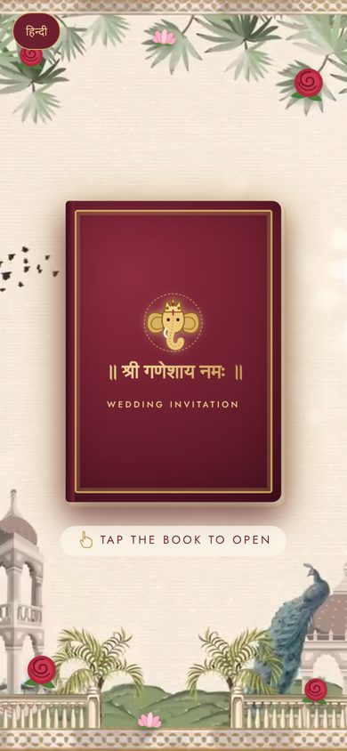
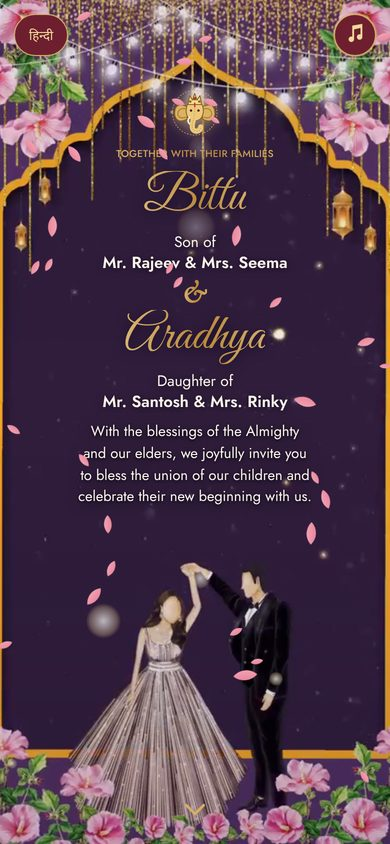
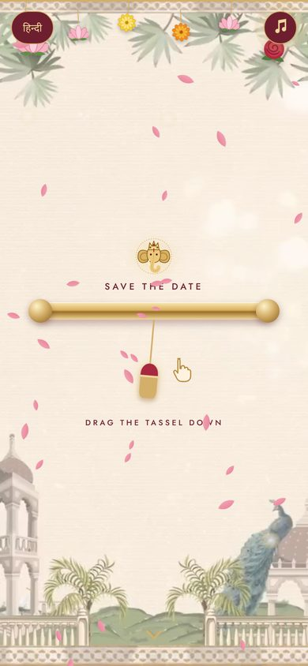
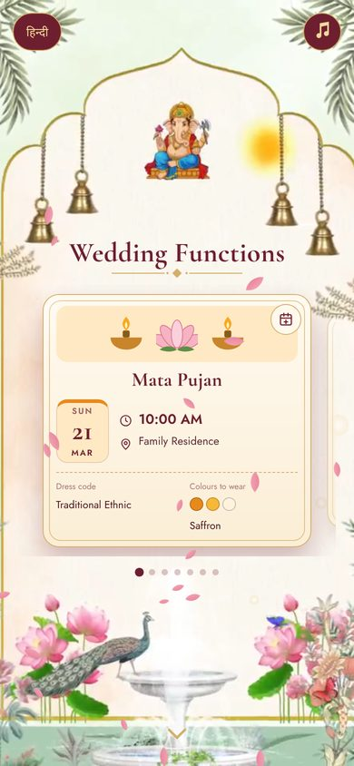
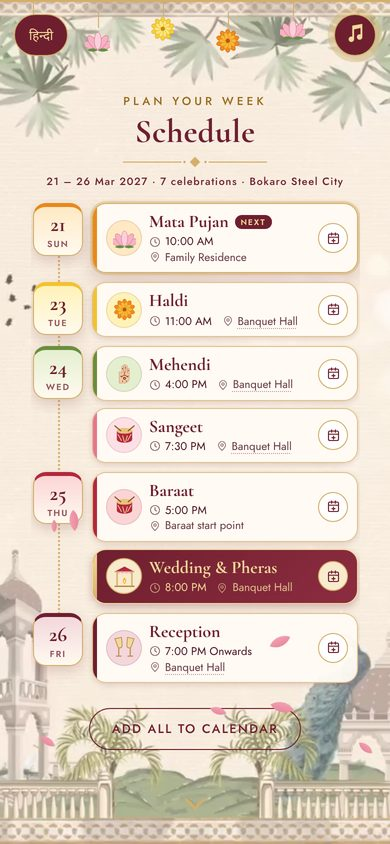
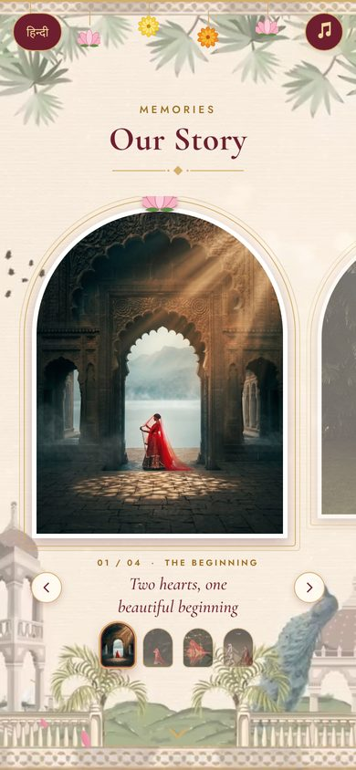
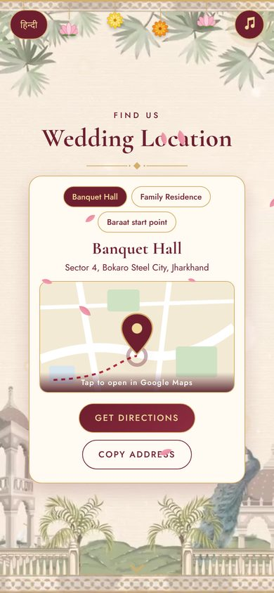
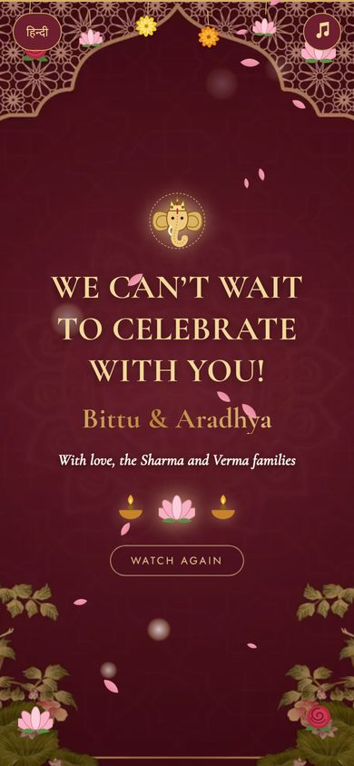

# 💍 Animated Wedding Invitation Website

A mobile-first, bilingual (English / हिंदी) **digital wedding invitation** built with plain HTML, CSS and vanilla JavaScript. No frameworks, no build step, and it loads fast (about 4 MB in total, fonts included).

> **Portfolio project.** This is a sample I built to showcase my work. Names, venues and dates are demo content.

**🔗 Live demo:** https://YOUR-USERNAME.github.io/YOUR-REPO-NAME/ *(best viewed on a phone)*

| | | | |
|:-:|:-:|:-:|:-:|
| <br>Cover | <br>Invitation | <br>Tassel reveal | <br>Function cards |
| <br>Schedule | <br>Our Story | <br>Location | <br>Closing |

## ✨ Features

- **Animated storytelling:** a loading screen, then a book cover that opens, then a scroll revealed by pulling a tassel, with video backgrounds, falling petals and typed names.
- **Bilingual:** one-tap English / हिंदी toggle with proper Devanagari fonts.
- **Live countdown:** time-zone aware (IST), and it switches to a "join us for the Reception" and then a "thank you" message as the wedding passes.
- **Smart schedule:** a timeline of events that automatically marks each one as *Next* or *Done*.
- **Add to Calendar:** download an `.ics` file (with a 1-day reminder) or open Google Calendar, for a single event or all events at once.
- **Function cards:** a 3D swipeable carousel with dress code and colour palette for each event.
- **"Our Story" gallery:** an arch-framed photo gallery with swipe, arrows and thumbnails.
- **Location help:** venue tabs, a "Get Directions" button that opens Google Maps, and a copy-address button.
- **Background music:** starts after the first tap (browsers block autoplay) and has a mute toggle.
- **Accessibility:** keyboard-operable cover and tassel, visible focus outlines, and `prefers-reduced-motion` support that disables the videos and particles.
- **Share-ready:** Open Graph / Twitter tags, a favicon, and a `<noscript>` fallback with the key details.

## 🛠️ Tech

HTML5 · CSS3 (custom properties, scroll-snap, 3D transforms) · Vanilla JavaScript (ES6, split into small modules) · IntersectionObserver · Web Audio · `.ics` generation in JS · Hosted on GitHub Pages or Vercel.

## 📁 Project structure

```
├── index.html              # Markup for all sections
├── css/style.css           # All styling (theme colours are CSS variables)
├── js/
│   ├── 01-core.js          # Helpers, reduced-motion check, petals
│   ├── 02-music.js         # Background music + toggle
│   ├── 03-intro.js         # Loading, book cover, tassel, countdown
│   ├── 04-content.js       # Names, events, venues, schedule, calendar
│   ├── 05-language.js      # English / Hindi translations
│   ├── 06-gallery.js       # Function carousel + "Our Story" gallery
│   └── 07-effects.js       # Scroll reveals, lazy-playing videos
├── assets/                 # fonts, photos, videos, music
├── docs/screenshots/       # Images used in this README
├── og.jpg                  # Link-preview image (1200×630)
└── vercel.json             # Optional: cache headers for Vercel
```

## 🚀 Run locally

No install needed. Because it loads videos and fonts, open it through a small local server instead of double-clicking the file:

```bash
git clone https://github.com/YOUR-USERNAME/YOUR-REPO-NAME.git
cd YOUR-REPO-NAME
python3 -m http.server 8000
# then open http://localhost:8000
```

## ✏️ Customising it for a new couple

| What to change | Where |
|---|---|
| Names (English + Hindi) | `NAMES` in `js/04-content.js`, and the parents' names in `index.html` |
| Events, dates, times, dress code | `F` array in `js/04-content.js` (dates look like `2027-03-25T20:00`) |
| Venues, addresses, map links | `V` object in `js/04-content.js` |
| Countdown target | `T` in `js/03-intro.js` |
| Phone / WhatsApp button | `CONTACT` in `js/04-content.js` (leave empty to hide it) |
| Gallery photos and captions | `P` array in `js/06-gallery.js` (photos go in `assets/photos/`) |
| Hindi text | `H` dictionary in `js/05-language.js` |
| Music | replace `assets/audio/music.mp3` |
| Link-preview image and URL | `og:` tags at the top of `index.html` and `og.jpg` |
| Colours | CSS variables at the top of `css/style.css` |

## 🌐 Deploy

**GitHub Pages:** go to *Settings → Pages → Build and deployment → Deploy from a branch → `main` / `(root)` → Save*. Your site will be live in about a minute.

**Vercel / Netlify:** import the repo, with no build command and the root as the output folder.

After deploying, update the `og:url` and `og:image` tags in `index.html` with your real URL so WhatsApp and Instagram show a proper preview.

## 📸 Credits and notes

- This is a demo, so the sample photos are **not mine** and are used here only to showcase the design. Photo credit: the fourth photo is by *TEAM DR – Dushyant Rawal Photography* (watermarked). **Replace all photos and the music with your own or licensed ones before using this for a real event.**
- Fonts (Cormorant Garamond, Great Vibes, Jost, Tiro Devanagari) are open-source Google Fonts, bundled locally.

## 💌 Want an invitation website like this?

I design and build custom digital wedding invitations (animated, bilingual, shareable by a single link).

- 👤 **[Your Name]**
- 📧 [your-email@example.com]
- 💬 WhatsApp: [+91 XXXXX XXXXX]
- 🔗 Portfolio: [your-portfolio-link]

## 📄 License

The code is free to learn from. For reuse, please contact me. The photos and music are **not** covered by this and belong to their respective owners.
